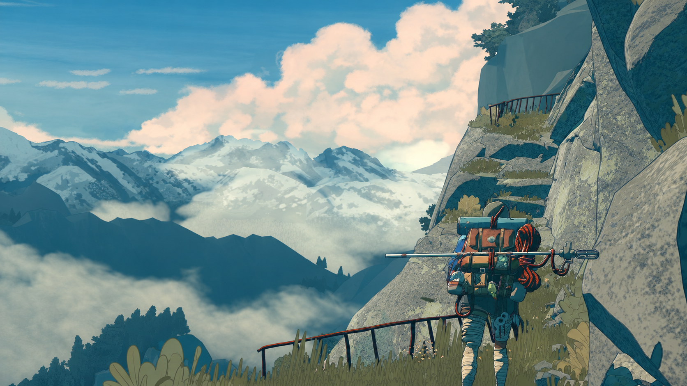
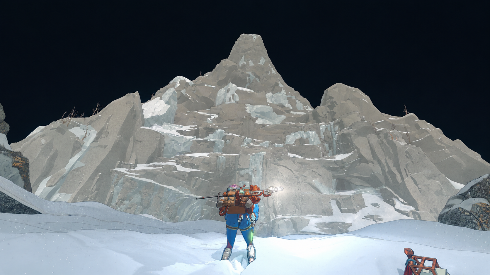

# 造山的人

《孤山独影》随记

> 循此苦旅，以抵繁星。
>
> ——拉丁格言 *Per aspera ad astra* 的意译。[10]

最近看《孤山独影》，很喜欢它的画面。暮色里紫红色的山，云海上的雪峰，还有背着一大包东西的登山者。人很小，山很大。光看截图，就想知道远处还有什么。

游戏的英文名是 Cairn。玩家扮演登山者艾瓦，去攀登一座从未有人登顶的山。路线要自己找，岩钉、食物和水也得省着用。[1]

攀爬是它的主要玩法。手抓哪里，脚踩哪里，身体能不能保持平衡，都要逐步调整。输入操作并不复杂，难的是判断落点和姿势。角色的呼吸、肢体的颤动，会提醒你她累了。[2]

山顶还很远，眼前先要找到下一处能站稳的地方。这样的玩法，配上这样的画面，让我开始好奇：谁会花这么多心思做一款爬山的游戏？

## 做游戏的人

它的开发商是 The Game Bakers，由 Emeric Thoa 和 Audrey Leprince 创立，游戏自己开发、自己发行。[3]

他们做过《Furi》和《Haven》，又做了《孤山独影》。三款游戏的玩法差别很大，却被他们放在了同一个主题里，叫“自由三部曲”：自由地活着，自由地爱一个人，以及超越自身限制、追求自由。[4]

Thoa 在访谈里说，做《孤山独影》时，他们想让玩家体会登山时身体和心理上的感受，因此选择了那些让动作更有深度、路线更自由的模拟机制。[5]

故事里的艾瓦也有自己的难处。她对自己苛刻，在艰难攀爬之后，站上岩台远眺的片刻，会感到自由。但她为此付出的代价，也落到了身边的人身上。Thoa 从登山故事里想到的是：我愿意为什么付出一切？我的山顶是什么？[6]

这个问题比登顶本身更让我感兴趣。山并没有要求谁爬上去，艾瓦却非去不可。

## 天空和背包

负责美术和编剧的 Mathieu Bablet 是一位漫画作者。团队做出早期的攀爬原型后找到了他。他带来的有插图，也有故事梗概。[7]

他住在阿尔卑斯山区，为了画出山里的氛围和颜色，拍了许多山景，以及一天中不同时刻的天空。还有一个细节我很喜欢：他知道玩家大部分时间会看着艾瓦的背包，于是在背包上花了很多心思，加了不少体现人物个性的细节。[5]

声音也做得很细。音频总监 Martin Stig Andersen 介绍，正对岩壁攀爬时，环境声会变轻，动作和呼吸声更突出；等到双脚站稳，周围的声音又会展开，有时还会响起音乐。[8]

爬的时候顾着眼前，站稳了，才有余裕看看风景。这些细节读起来并不复杂，但要把它们一一做进游戏里，应该很费工夫。

## 还得把山造出来

开发中有个麻烦，是团队起初没有料到的。新的攀爬系统做出来了，原来的关卡制作方法却不适用。他们还得研究怎么造一座适合这样攀爬的山，把岩石一块块手工摆放、组合。玩家可以自己找路，有些路线连开发者都没想到。[5][9]

我觉得做 Agent 也会遇到类似的问题。比如，想让用户能反复修改一篇文章，就得认真处理每次修改会动到什么、已经确认的内容怎么保留。

假设我请 Agent 帮忙写文章。我已经选好了几个段落，现在只想给其中一个观点补证据。我说“这段保留”，下一稿就该保留；我说“试试另一个开头”，也不意味着整篇都要重写。查到的新资料如果推翻了原来的判断，把证据拿给我，我们再改。

真要这样用，稿件就得分得清版本，修改也得留下记录。否则每次收到新稿，我都要从头读一遍，检查哪些地方又被改了。

我也不想一直盯着它。检索、整理、核对，它可以自己往前做。等我回来，告诉我补了什么、哪里还拿不准、哪一处需要我决定。试过的新版本不喜欢，能退回去；已经改好的地方，就留在那里。

这里和游戏有个区别。游戏可以让人从费力的过程里获得乐趣，工作中的许多麻烦则完全可以省掉。我想保留的是对内容的判断，比如这篇文章到底要说什么，哪些话我愿意写下来。至于为了把它写出来，要来回搬运多少资料、重复多少次操作，当然越少越好。

游戏作者在做自己的作品，创作类 Agent 则要帮助别人完成他们的作品。做产品的人当然有自己的偏好，也得给使用者的偏好留位置。他想改的地方，应该改得动；他想留下的东西，也应该留得住。

看过这些访谈，我对《孤山独影》的喜欢，多了一点对做出它的人的羡慕。他们想做的事，从山的样子到背包上的细节，都做进去了。我也想把手头的产品做得这么仔细。

## 资料来源

1. [游戏官网](https://www.thegamebakers.com/cairn/)
2. [玩法介绍](https://www.thegamebakers.com/cairn-in-depth-gameplay-presentation/)
3. [工作室](https://www.thegamebakers.com/our-studio/)
4. [自由三部曲访谈](https://www.fixgamingchannel.com/cairn-a-survival-climber-that-challenges-every-handhold-fix-gaming-channel/)
5. [美术与玩法访谈](https://infinity-area.com/article/interview-avec-les-developpeurs-de-cairn)
6. [人物与故事](https://blog.playstation.com/2025/12/04/cairn-the-climb-of-a-lifetime-starts-january-29-2026/)
7. [创作访谈](https://www.pointnthink.fr/en/emeric-thoa-cairn-2/)
8. [声音设计](https://www.asoundeffect.com/cairn-game-audio/)
9. [山体与关卡](https://www.gamatomic.com/interviews/13491/cairn)
10. [题记参考](https://marxism.muc.edu.cn/info/1271/1652.htm)

游戏画面 © The Game Bakers
